 

 

## ▍Sobre mí

 

## ▍Stack

 

## ▍Proyectos destacados

[**Ver todos mis repositorios →**](https://github.com/mxnueh?tab=repositories)

 

## ▍Hablemos

¿Tienes una idea, un proceso que automatizar o un sistema por construir? Escríbeme a [enmanuelnunezmatias@gmail.com](mailto:enmanuelnunezmatias@gmail.com) o por [LinkedIn](https://www.linkedin.com/in/enmanuel-nunez-matias-249560340/).

 

